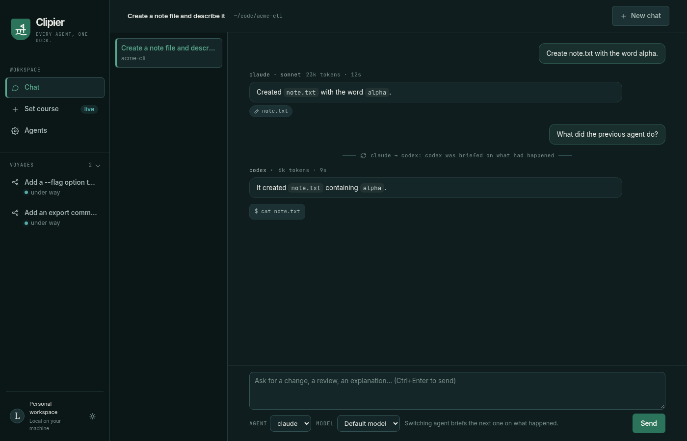
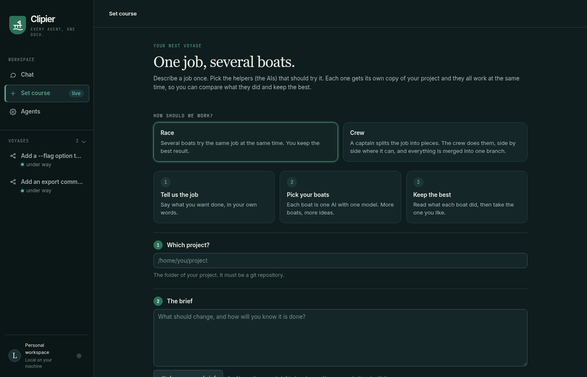
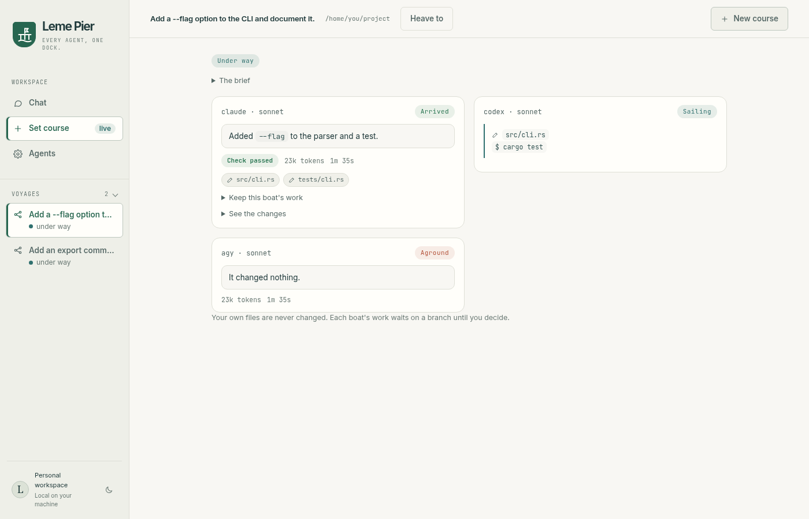
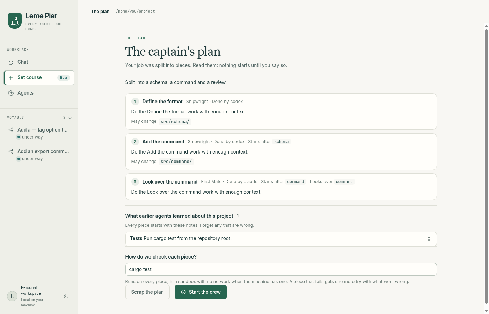
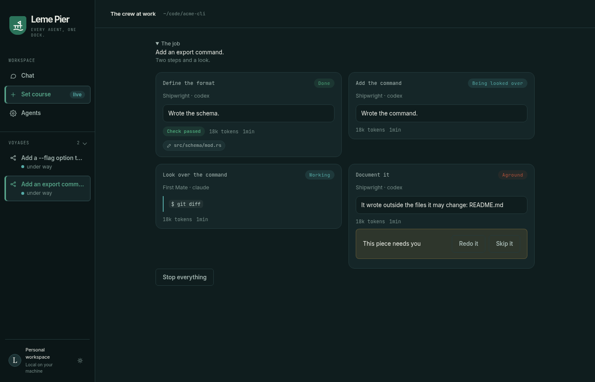
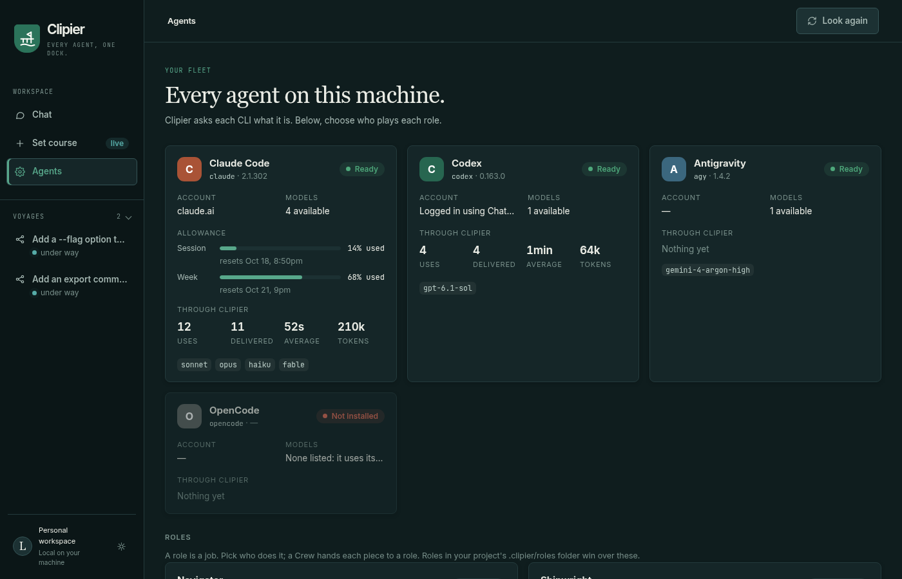
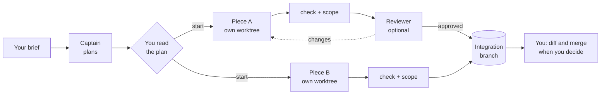

<p align="center"></p>

<h1 align="center">Clipier</h1>

<p align="center"><strong>Every agent, one dock.</strong></p>

<p align="center">
  <a href="#what-it-does"><strong>What it does</strong></a> &middot;
  <a href="#install"><strong>Install</strong></a> &middot;
  <a href="#how-a-crew-works"><strong>How a crew works</strong></a> &middot;
  <a href="#roles-and-project-settings"><strong>Roles</strong></a> &middot;
  <a href="ARCHITECTURE.md"><strong>Architecture</strong></a> &middot;
  <a href="SECURITY.md"><strong>Security</strong></a> &middot;
  <a href="CONTRIBUTING.md"><strong>Contributing</strong></a> &middot;
  <a href="README.pt-BR.md"><strong>Português</strong></a>
</p>

<p align="center">
  <a href="https://github.com/lucaswotta/clipier/actions/workflows/ci.yml"></a>
  <a href="LICENSE"></a>
  
  <a href="https://github.com/lucaswotta/clipier/stargazers"></a>
  
  
  
  
  
  
</p>

<p align="center">
  
  
  
  
  
</p>

<p align="center">
  
</p>

Clipier is a desktop app that finds the AI coding CLIs already installed and signed in on your machine (`claude`, `codex`, `agy`, `opencode`) and lets you use them from one place. It starts the official CLIs with the sign-ins you already made, sends nothing anywhere by itself, and keeps no account.

If you pay for more than one coding agent, you know the cost of switching: the next agent has to read the whole repository again, and you cannot easily ask three of them the same thing and compare. Clipier keeps one record of what was said and done, so the next agent is briefed on what it missed instead of starting cold, and it runs agents side by side, each on its own copy of your project.

## What it does

|  |  |
|---|---|
| **Chat** | One conversation you can continue with another agent or model. A reply names the agent and model that wrote it. When the agent changes, the next one gets a short briefing built *without a model call*: what it has not seen, the state of the repository and the project's notes. An agent that spoke last resumes its own session with no briefing at all. |
| **Race** | One brief sent to up to four agent and model pairs at once, each on its own git worktree. Your project's check (its tests) runs on each result and the work waits on a branch per boat: you read what each did and keep one, by merging it yourself or with a button that opens a pull request. |
| **Crew** | A captain role splits a brief into pieces. You read the plan, then the pieces run side by side where they do not depend on each other. Each is checked, can be looked over by a reviewer, and merges into one integration branch. It asks you only when a piece fails, does not merge, or is turned back twice. When it is done, one click opens a pull request from the integration branch. |
| **Notes** | Facts about your project that agents leave for the next one (a command, a convention), kept as plain markdown files you can read and delete. |
| **Agents** | What each CLI says about itself: version, sign-in, models, how much of the Claude allowance is used, what has gone through Clipier, and who plays each role. |

<table>
  <tr>
    <td width="50%"><br><sub><b>Set course.</b> One brief, two ways to work, in plain words.</sub></td>
    <td width="50%"><br><sub><b>Race.</b> Three boats on the same brief: one arrived, one is working, one ran aground.</sub></td>
  </tr>
  <tr>
    <td width="50%"><br><sub><b>The plan.</b> Read it before anything starts.</sub></td>
    <td width="50%"><br><sub><b>The crew at work.</b> A failed piece asks you: redo it or skip it.</sub></td>
  </tr>
  <tr>
    <td colspan="2"><br><sub><b>Agents.</b> What each CLI reported, the Claude allowance, usage through Clipier and who plays each role.</sub></td>
  </tr>
</table>

## Install

Linux is complete. Windows is built and tested by CI on every push, but has not been used with real agents yet.

**Requirements:** `git`, at least one of the agent CLIs signed in, and `bubblewrap` (`bwrap`). Bubblewrap is recommended for everyone, because it lets the project's check run with no network, and required for `agy` and `opencode`, which run commands without asking.

There is no release yet. Build the `.deb`:

```sh
git clone https://github.com/lucaswotta/clipier
cd clipier/app
npm ci && npm run build
npx tauri build --bundles deb       # ../target/release/bundle/deb/
sudo apt install ../target/release/bundle/deb/*.deb
```

Or run it from source with `npm run tauri dev`. You need Rust (stable), Node and the Tauri system libraries; [CONTRIBUTING.md](CONTRIBUTING.md) lists them. The program is called `clipier`.

## How a crew works



Pieces that do not wait for each other run at the same time. A piece may change only the files its plan lists; anything else is reported and blocks the merge. Conflicts are never forced.

## Roles and project settings

A role is a markdown file: who does a job and how they are told to. The built-in roles are `captain`, `builder`, `reviewer` and `tester`; put your own in `~/.config/clipier/roles/` or, to share them with a team, in `.clipier/roles/` in the repository.

```markdown
---
name: builder
mode: write
agent: codex
model: ""                 # empty: the CLI's own default
fallback:                 # used once, only if the agent is unavailable
  agent: claude
  model: sonnet
---
You implement the piece you are given inside this worktree. Change only what the piece needs.
```

`.clipier/config.toml` is optional:

```toml
check = "cargo test"      # what a piece must pass
approve_plan = true       # false: the crew starts as soon as the plan is valid
parallel = 3              # pieces that may run at the same time
```

## Safe by construction

A Race or a Crew never touches your checkout, branch or index: agents work in git worktrees and the result is verified at the end. The check runs with secrets removed and, where there is a sandbox, with no network. Agents that run commands without asking only run inside a sandbox. Notes that look like credentials are refused. [SECURITY.md](SECURITY.md) says what is and is not guaranteed: a Chat, for example, edits the folder you point it at, as the CLI would in a terminal.

No accounts, no telemetry, no model API keys, no plugins, no background runs. The only network request Clipier makes itself is to GitHub, and only when you click *Open a pull request* ([how it signs in](docs/GITHUB.md)). It is a tool you sit in front of.

## Status

Early: the first release is 0.0.1. [ARCHITECTURE.md](ARCHITECTURE.md) says how it is built and why it is small on purpose (about 5,100 lines of Rust). Whether the briefing really makes the next agent cheaper than starting cold is an assumption with one data point so far; it will be measured and the result published either way.

The agents run under your own sign-ins and your own allowance. What each vendor's terms say about driving their CLIs from another program is in [docs/VENDOR_TERMS.md](docs/VENDOR_TERMS.md).

If Clipier saves you time, a star helps other people find it. Issues and pull requests are welcome: see [CONTRIBUTING.md](CONTRIBUTING.md). To add another agent CLI, start with the [issue template](.github/ISSUE_TEMPLATE/agent.md).

## License

[Apache-2.0](LICENSE)
