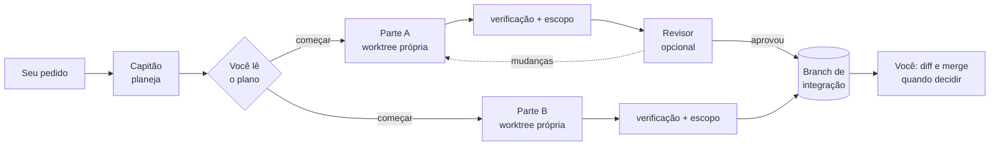

<p align="center"></p>

<h1 align="center">Clipier</h1>

<p align="center"><strong>Todos os agentes, um só cais.</strong></p>

<p align="center">
  <a href="#o-que-ele-faz"><strong>O que ele faz</strong></a> &middot;
  <a href="#instalação"><strong>Instalação</strong></a> &middot;
  <a href="#como-uma-tripulação-trabalha"><strong>Como a tripulação trabalha</strong></a> &middot;
  <a href="#papéis-e-ajustes-do-projeto"><strong>Papéis</strong></a> &middot;
  <a href="ARCHITECTURE.pt-BR.md"><strong>Arquitetura</strong></a> &middot;
  <a href="SECURITY.md"><strong>Segurança</strong></a> &middot;
  <a href="CONTRIBUTING.md"><strong>Contribuir</strong></a> &middot;
  <a href="README.md"><strong>English</strong></a>
</p>

<p align="center">
  <a href="https://github.com/lucaswotta/clipier/actions/workflows/ci.yml"></a>
  <a href="LICENSE"></a>
  
  <a href="https://github.com/lucaswotta/clipier/stargazers"></a>
  
  
  
  
  
  
</p>

<p align="center">
  
  
  
  
  
</p>

<p align="center">
  
</p>

O Clipier é um app de desktop que encontra os CLIs de IA para programar já instalados e com login na sua máquina (`claude`, `codex`, `agy`, `opencode`) e deixa você usá-los num só lugar. Ele inicia os CLIs oficiais com os logins que você já fez, não envia nada para lugar nenhum por conta própria e não guarda conta.

Se você paga por mais de um agente de código, conhece o custo de trocar: o próximo agente precisa reler o repositório inteiro, e não dá para fazer a mesma pergunta a três deles e comparar sem esforço. O Clipier guarda um só registro do que foi dito e feito, então o próximo agente é posto a par do que perdeu em vez de começar do zero, e roda agentes lado a lado, cada um na sua própria cópia do projeto.

## O que ele faz

|  |  |
|---|---|
| **Conversa** | Uma conversa que você pode continuar com outro agente ou modelo. Cada resposta diz qual agente e modelo a escreveu. Quando o agente muda, o próximo recebe um briefing curto montado *sem chamar modelo*: o que ele não viu, o estado do repositório e as notas do projeto. O agente que falou por último retoma a própria sessão, sem briefing. |
| **Regata** | Um pedido enviado a até quatro pares de agente e modelo ao mesmo tempo, cada um na sua git worktree. A verificação do projeto (os testes dele) roda em cada resultado, e o trabalho espera numa branch por barco: você lê o que cada um fez e fica com um, reunindo você mesmo ou com um botão que abre um pull request. |
| **Tripulação** | Um papel de capitão divide o pedido em partes. Você lê o plano, e então as partes rodam lado a lado onde não dependem uma da outra. Cada uma é verificada, pode ser revisada e é reunida numa branch de integração. Ele só pergunta a você quando uma parte falha, não se junta limpa ou é devolvida duas vezes. Ao terminar, um clique abre um pull request a partir da branch de integração. |
| **Notas** | Fatos sobre o seu projeto que os agentes deixam para o próximo (um comando, uma convenção), guardados como arquivos markdown que você pode ler e apagar. |
| **Agentes** | O que cada CLI diz de si: versão, login, modelos, quanto da cota do Claude foi usada, o que passou pelo Clipier e quem faz cada papel. |

<table>
  <tr>
    <td width="50%"><br><sub><b>Set course.</b> Um pedido, duas formas de trabalhar, em palavras simples.</sub></td>
    <td width="50%"><br><sub><b>Regata.</b> Três barcos no mesmo pedido: um chegou, um trabalha, um encalhou.</sub></td>
  </tr>
  <tr>
    <td width="50%"><br><sub><b>O plano.</b> Leia antes de qualquer coisa começar.</sub></td>
    <td width="50%"><br><sub><b>A tripulação em ação.</b> Uma parte que falhou pergunta a você: refazer ou pular.</sub></td>
  </tr>
  <tr>
    <td colspan="2"><br><sub><b>Agentes.</b> O que cada CLI informou, a cota do Claude, o uso pelo Clipier e quem faz cada papel.</sub></td>
  </tr>
</table>

As telas acima estão em inglês; o app segue o idioma do sistema (inglês, português do Brasil ou espanhol).

## Instalação

O Linux está completo. O Windows é compilado e testado pelo CI a cada push, mas ainda não foi usado com agentes de verdade.

**Requisitos:** `git`, pelo menos um dos CLIs de agente com login e `bubblewrap` (`bwrap`). O bubblewrap é recomendado para todos, porque deixa a verificação do projeto rodar sem rede, e é necessário para `agy` e `opencode`, que rodam comandos sem perguntar.

Ainda não há versão publicada. Gere o `.deb`:

```sh
git clone https://github.com/lucaswotta/clipier
cd clipier/app
npm ci && npm run build
npx tauri build --bundles deb       # ../target/release/bundle/deb/
sudo apt install ../target/release/bundle/deb/*.deb
```

Ou rode a partir do código com `npm run tauri dev`. Precisa de Rust (stable), Node e das bibliotecas de sistema do Tauri; o [CONTRIBUTING.md](CONTRIBUTING.md) lista tudo. O programa se chama `clipier`.

## Como uma tripulação trabalha



As partes que não dependem uma da outra rodam ao mesmo tempo. Uma parte só pode mudar os arquivos que o plano lista; qualquer outra coisa é apontada e bloqueia a reunião. Conflito nunca é forçado.

## Papéis e ajustes do projeto

Um papel é um arquivo markdown: quem faz um trabalho e como é instruído. Os papéis de fábrica são `captain`, `builder`, `reviewer` e `tester`; ponha os seus em `~/.config/clipier/roles/` ou, para compartilhar com um time, em `.clipier/roles/` no repositório.

```markdown
---
name: builder
mode: write
agent: codex
model: ""                 # vazio: o padrão do CLI
fallback:                 # usado uma vez, só se o agente estiver indisponível
  agent: claude
  model: sonnet
---
Você implementa a parte que recebeu dentro desta worktree. Mude só o que a parte precisa.
```

O `.clipier/config.toml` é opcional:

```toml
check = "cargo test"      # o que uma parte precisa passar
approve_plan = true       # false: a tripulação começa assim que o plano é válido
parallel = 3              # partes que podem rodar ao mesmo tempo
```

## Seguro por construção

Uma Regata ou uma Tripulação nunca toca no seu checkout, na sua branch nem no seu índice: os agentes trabalham em git worktrees, e o resultado é verificado no fim. A verificação roda sem segredos e, onde há sandbox, sem rede. Agentes que rodam comandos sem perguntar só rodam dentro de um sandbox. Notas que parecem credenciais são recusadas. O [SECURITY.md](SECURITY.md) diz o que é e o que não é garantido: uma Conversa, por exemplo, edita a pasta que você apontou, como o CLI faria num terminal.

Sem contas, sem telemetria, sem chaves de API de modelo, sem plugins, sem execuções em segundo plano. A única requisição de rede que o Clipier faz por conta própria é ao GitHub, e só quando você clica em *Abrir um pull request* ([como ele entra](docs/GITHUB.md)). É uma ferramenta diante da qual você se senta.

## Status

Inicial: a primeira versão é a 0.0.1. O [ARCHITECTURE.pt-BR.md](ARCHITECTURE.pt-BR.md) diz como ele é construído e por que é pequeno de propósito (cerca de 5.100 linhas de Rust). Se o briefing realmente deixa o próximo agente mais barato que começar do zero é uma suposição com um único dado até agora; será medido e o resultado publicado nos dois casos.

Os agentes rodam com os seus próprios logins e a sua própria cota. O que os termos de cada fornecedor dizem sobre dirigir os CLIs por outro programa está em [docs/VENDOR_TERMS.md](docs/VENDOR_TERMS.md) (em inglês).

Se o Clipier economizar o seu tempo, uma estrela ajuda outras pessoas a encontrá-lo. Issues e pull requests são bem-vindos: veja o [CONTRIBUTING.md](CONTRIBUTING.md). Para incluir outro CLI de agente, comece pelo [modelo de issue](.github/ISSUE_TEMPLATE/agent.md).

## Licença

[Apache-2.0](LICENSE)
